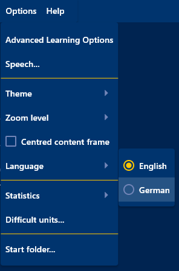

# Schnellstart für Windows

**Etwa 10 Minuten · ein Windows-PC · kein Konto, keine Anmeldung**

*In English: [Quick start for Windows](QUICKSTART.md)*

Das wirst du tun:

1. Learn Anywhere auf deinen PC bringen.
2. Eine fertige Liste mit englischen Wörtern einrichten.
3. Deine ersten Wörter üben.

Geh die Schritte der Reihe nach durch. Du musst noch nicht alles verstehen. Bei jedem
Schritt steht, was du danach sehen solltest, so weißt du immer, dass du richtig bist.

## Teil 1: Deine erste Übung

### 1. Programm herunterladen

Klick hier: **[Learn Anywhere 1.2.0 für Windows herunterladen](https://github.com/PescheHelfer/LearnAnywhere/releases/download/desktop-v1.2.0/Learn_Anywhere-1.2.0-x86_64.zip)**
(eine ZIP-Datei, etwa 13 MB).

*Dein Browser speichert `Learn_Anywhere-1.2.0-x86_64.zip`, meist im Ordner
`Downloads`.*

Falls der Link nicht funktioniert, öffne die [Releases-Seite](https://github.com/PescheHelfer/LearnAnywhere/releases), such die
neueste Version, deren Tag mit `desktop-v` beginnt, und klick auf die Datei, bei der
**Windows** steht.

### 2. ZIP-Datei entpacken

Öffne deinen Ordner `Downloads`, klick mit der rechten Maustaste auf die ZIP-Datei und
wähle **Alle extrahieren…**.

Benenne im Fenster, das sich öffnet, das Zielverzeichnis in `LearnAnywhere` um und klick
dann auf **Extrahieren**:

> [!IMPORTANT]
> Starte das Programm nicht mit Doppelklick, solange es noch *in* der ZIP-Datei liegt.
> Windows startet dann eine vorübergehende Kopie ohne die Dateien, die das Programm
> braucht, und es kann nicht richtig laufen. Immer zuerst entpacken.

### 3. Programm an seinen Platz verschieben

Programme ohne Installationsprogramm kannst du beispielsweise in deinem persönlichen Programmordner ablegen. Das benötigt keine Admin-Rechte.

1. Wähle den Ordner aus Schritt 2 (...\Downloads\LearnAnywhere)
2. Drück `Strg+X`, um ihn auszuschneiden.
3. Klick oben im Fenster in die Adressleiste, tippe `%LOCALAPPDATA%\Programs` und drück
   `Enter`.
4. Drück `Strg+V`, um den Ordner dort einzufügen.

*Das Programm liegt jetzt in `%LOCALAPPDATA%\Programs\LearnAnywhere`.*

Meldet Windows, dass es den Ordner nicht findet, tippe stattdessen `%LOCALAPPDATA%`,
erstelle einen neuen Ordner namens `Programs` (`Strg+Umschalt+N`), öffne ihn und füge
dort ein.

Andere Orte, die auch gehen

- **Dokumente oder Desktop**: leicht zu finden, aber eigentlich nicht für Programme gedacht.
- **C:\Program Files**: der klassische Ort, aber dort darf nur etwas ablegen, wer
  Administratorrechte hat.

### 4. Verknüpfung erstellen

Öffne den Ordner `LearnAnywhere`, den du gerade eingefügt hast. Klick mit der rechten
Maustaste auf `LearnAnywhere.exe` und wähle **Senden an ▸ Desktop (Verknüpfung
erstellen)**. Unter Windows 11 steckt **Senden an** hinter **Weitere Optionen
anzeigen**.

*Auf deinem Desktop erscheint ein Learn-Anywhere-Symbol. Ab jetzt startest du das
Programm von dort (siehe Kapitel 6).*

### 5. Beispielwörter in deine Dokumente kopieren

Bewahre deine Lern-Dateien im Ordner `Dokumente` auf, getrennt vom Programm. Ein Update des
Programms würde sie ersetzen, wenn sie im Programmordner lägen.

1. Öffne im Ordner `LearnAnywhere` den Ordner `Examples`.
2. Klick den Ordner `English` einmal an und drück `Strg+C`, um ihn zu kopieren.
3. Klick in der linken Spalte des Fensters auf **Dokumente**.
4. Erstelle einen neuen Ordner (`Strg+Umschalt+N`), nenne ihn `LearnAnywhere` und öffne
   ihn.
5. Drück `Strg+V`, um den kopierten English-Ordner einzufügen.

*Du hast jetzt den Ordner `Dokumente\LearnAnywhere\English` mit zwei Dateien darin:
`FamilyRelations.vok` und `English.inf`.*

Siehst du neben **Dokumente** ein kleines Wolken-Symbol? Dann gehört der Ordner zu
OneDrive, und deine Lern-Dateien werden automatisch gesichert.

Auf dieselbe Weise kannst du auch Lern-Dateien hinzufügen, die du z.B. von Kolleg*innen
erhalten hast.

### 6. Learn Anywhere starten

Doppelklick auf das neue Symbol auf deinem Desktop.

Beim ersten Mal zeigt Windows vielleicht ein blaues Fenster: **Der Computer wurde durch
Windows geschützt**.

> [!IMPORTANT]
> Klick auf **Weitere Informationen** und dann auf **Trotzdem ausführen**. Windows zeigt
> diese Warnung bei jedem Programm, das nicht mit einem kostenpflichtigen Zertifikat
> signiert ist und aus dem Internet heruntergeladen worden ist. Learn Anywhere ist 
> kostenlos und hat kein Zertifikat. Du siehst die Warnung nur einmal.

*Das Programm öffnet sich und zeigt **No file loaded**.*

Das Programm startet auf Englisch. Stell es auf Deutsch um: Wähle **Options ▸ Language ▸
German**. *Jetzt steht dort **Keine Datei geladen**.*

### 7. Die Beispiel-Lern-Datei öffnen

Wähle **Datei ▸ Lerneinheiten laden...**, geh zu `Dokumente\LearnAnywhere\English` und
öffne `FamilyRelations.vok`.

*Das Programm meldet **Lern-Datei geladen.***

So eine Datei heißt **Lern-Datei**, und jede Karte darin ist eine **Lerneinheit**. Diese
Lern-Datei enthält 68 englische Wörter rund um die Familie, viele mit einem Beispielsatz.

### 8. Die Übung einrichten

Wähle **Lern ▸ Übung einrichten**. Wähle unter **Modus** den Eintrag **Drill-Modus** oder **Stufenlernen**.
Lass alles andere, wie es ist, und drück **Sitzung starten**.

**Stufenlernen** fängt leicht an und wird schwerer, je besser du wirst: Zuerst siehst du die
ganze Antwort, später nur noch einige Buchstaben und am Schluss gar nichts mehr.

**Drill-Modus** bietet keine Hilfe und erwartet direkt die ganze Eingabe. Das entspricht der letzten Stufe des Stufenlernens.

In beiden Fällen wird eine Einheit so lange abgefragt, bis sie in mindestens 40 % (Beherrschungsschwelle) aller Abfrageversuche korrekt beantwortet worden ist. Beim Stufenlernen beginnt dieser Zähler erst ab der letzten Stufe.

### 9. Deine erste Karte beantworten

Im **Stufenlernen** zeigt das Programm ein deutsches Wort zusammen mit seiner englischen
Übersetzung.

1. Drück **Verdecken & tippen** (`F10`). *Das englische Wort verschwindet.*
2. Tippe es aus dem Gedächtnis und drück `Enter`. *Das Programm sagt dir, ob es richtig
   war.*
3. Drück noch einmal `Enter` für die nächste Karte.

Im **Drill-Modus** siehst du nur das deutsche Wort. Tippe das englische Wort direkt ein
und drück `Enter`, dann noch einmal `Enter` für die nächste Karte.

Mit `Esc` hörst du auf, wann immer du willst. Dein Fortschritt wird automatisch
gespeichert.

## Geschafft! 🎉

Du hast Learn Anywhere installiert und deine ersten Wörter geübt.

Beim nächsten Mal steht deine Lern-Datei auf dem ersten Bildschirm unter **Zuletzt
verwendete Lern-Dateien**. Ein Klick öffnet sie, und das Programm weiß noch, wie gut du
jedes Wort schon kannst.

Alles Weitere ist freiwillig. Komm darauf zurück, wann immer du Lust hast.

## Teil 2: Deine eigenen Wörter lernen

Willst du die Wörter aus deinem eigenen Schulbuch üben? Nimm einfach die **Maske** des
Beispiels: die Datei `English.inf`, die festlegt, wie eine Karte aussieht (ein deutsches
Feld, ein englisches Feld und Platz für Notizen). Dann musst du nur noch deine Wörter
eintippen.

1. Wähle **Datei ▸ Lerneinheiten im Speicher löschen...** und bestätige. *Auf deiner
   Festplatte wird nichts gelöscht.*
2. Wähle **Vorhandene Maske laden...** und öffne `English.inf` in
   `Dokumente\LearnAnywhere\English`.
3. Wähle **Edit ▸ Eingabe-Maske** und drück **Einfügen**.
4. Wähle unter **Kategorie wählen** den Eintrag **1 Zeile**: ein deutsches Wort, ein
   englisches Wort.
5. Tippe das deutsche Wort ins Feld **DEUTSCH**, drück `Tab` und tippe das englische
   Wort ins Feld **ENGLISCH**. Die Felder **Bemerkungen** sind für Notizen; du kannst sie
   leer lassen.
6. Drück **Weiter** (`F3`) für das nächste Wort und mach so weiter. Wenn du fertig bist,
   drück **Fertig**.
7. Wähle **Datei ▸ Lerneinheiten speichern unter...**, geh zu
   `Dokumente\LearnAnywhere\English` und speichere unter einem eigenen Namen, zum
   Beispiel `MeineWoerter.vok`.

Dann übst du sie genau wie in den Schritten 8 und 9.

**Ein anderes Fach?** Erstelle dafür einen Ordner neben `English`, zum Beispiel
`Dokumente\LearnAnywhere\Franz`. Eine neue Sprache braucht eine eigene Maske, die du im
Mask Editor erstellst (siehe Teil 3).

**Viele Wörter zum Abtippen?** Das Dateiformat ist reiner Text und
[dokumentiert](docs/file-formats.md), deshalb kann ein KI-Chatbot aus einem Foto deiner
Wörterliste eine Lern-Datei für dich machen.

## Teil 3: Weiter geht's

Das vollständige Benutzerhandbuch ist ins Programm eingebaut: Drück `F1` oder wähle
**Hilfe ▸ Benutzerhandbuch**. Dieselben Kapitel gibt es hier auf GitHub:

- [Der Mask Editor](packages/ui_kit/assets/help/de/05-mask-editor.md): deine eigene
  Maske erstellen, zum Beispiel für Französisch oder für Verben mit allen Formen.
- [Grundbegriffe](packages/ui_kit/assets/help/de/02-concepts.md): Lern-Datei, Maske,
  Lerneinheit und die anderen Wörter, die das Handbuch verwendet.
- [Lernsitzungen](packages/ui_kit/assets/help/de/06-learning-sessions.md): die vier
  Arten zu üben.
- [Statistik](packages/ui_kit/assets/help/de/09-statistics.md): sehen, was du schon
  kannst und was du immer wieder falsch machst.
- [Sprachausgabe](packages/ui_kit/assets/help/de/15-speech.md): deine Wörter vorlesen
  lassen.
- [Die Android-Begleit-App](packages/ui_kit/assets/help/de/14-android-companion.md): auf
  dem Handy üben.
