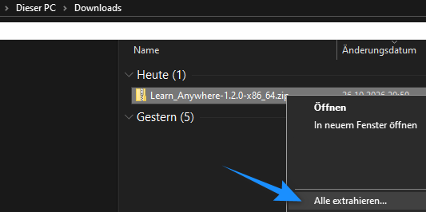
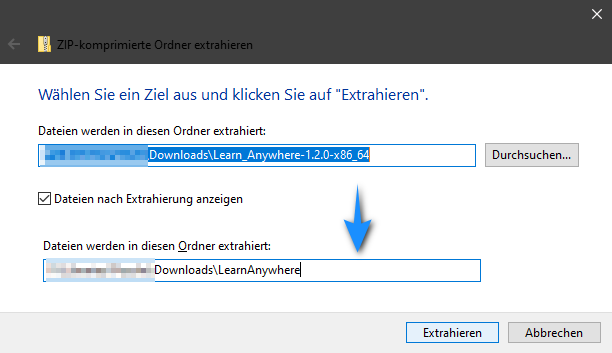
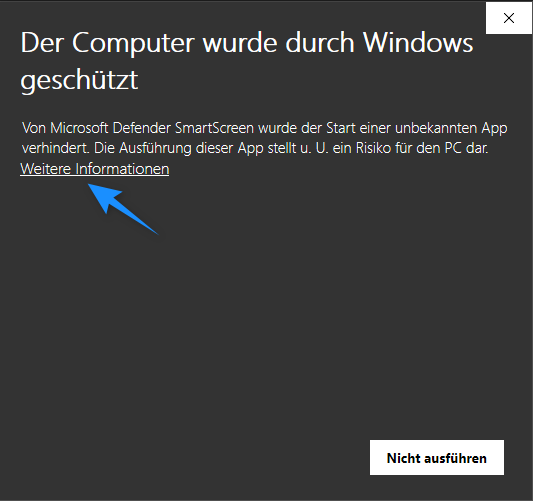
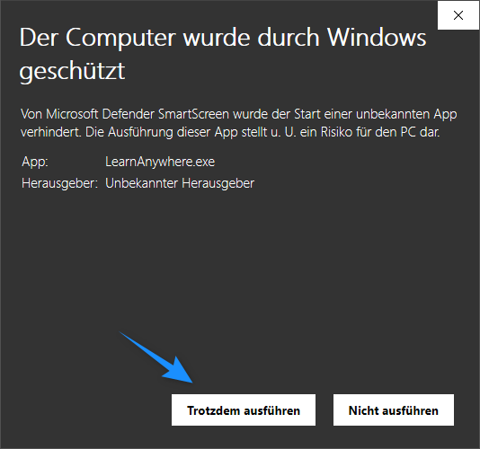
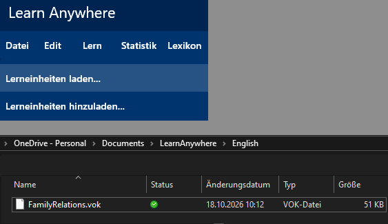
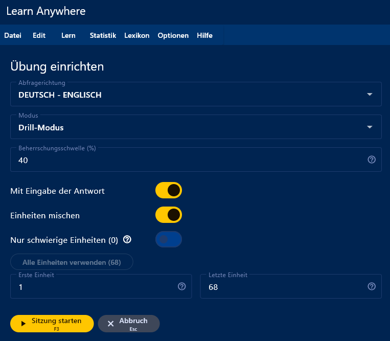
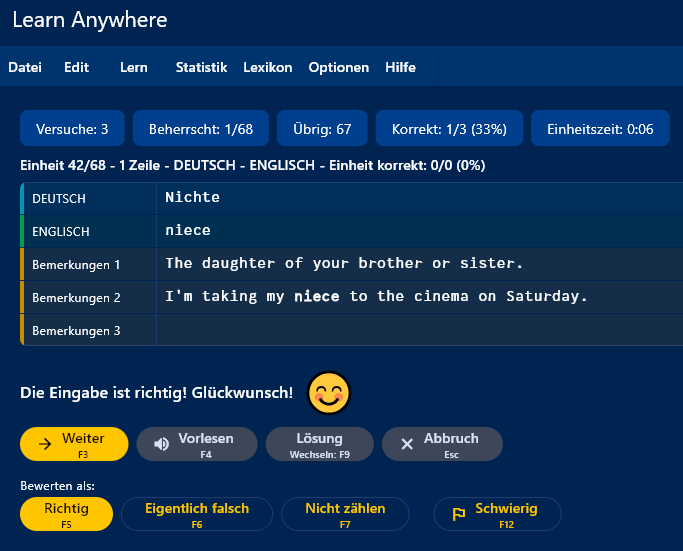

# Quick start for Windows

**About 10 minutes · a Windows PC · no account, no sign-up**

*Auf Deutsch: [Schnellstart für Windows](QUICKSTART.de.md)*

Here is what you are going to do:

1. Put Learn Anywhere on your PC.
2. Set up a ready-made list of English words.
3. Practise your first words.

Follow the steps in order. You don't need to understand everything yet. Each step tells
you what you should see afterwards, so you always know you're on track.

*The screenshots were taken on a German Windows, so their labels are in German.*

## Part 1: Your first practice session

### 1. Download the program

Click here: **[Download Learn Anywhere 1.2.0 for Windows](https://github.com/PescheHelfer/LearnAnywhere/releases/download/desktop-v1.2.0/Learn_Anywhere-1.2.0-x86_64.zip)**
(a ZIP file, about 13 MB).

*Your browser saves `Learn_Anywhere-1.2.0-x86_64.zip`, usually in your `Downloads`
folder.*

If the link doesn't work, open the
[Releases page](https://github.com/PescheHelfer/LearnAnywhere/releases), find the newest
release whose tag starts with `desktop-v`, and click the file marked **Windows**.

### 2. Unpack the ZIP file

Open your `Downloads` folder, right-click the ZIP file and choose **Extract All…**.

In the window that opens, change the name of the destination folder to `LearnAnywhere`,
then click **Extract**:

> [!IMPORTANT]
> Don't double-click the program while it is still *inside* the ZIP file. Windows then
> starts a temporary copy without the files the program needs, and it can't work
> properly. Always extract first.

### 3. Move the program to its place

Programs without an installer can go in your personal programs folder, for example.
That doesn't need administrator rights.

1. Select the folder from step 2 (`...\Downloads\LearnAnywhere`).
2. Press `Ctrl+X` to cut it.
3. Click into the address bar at the top of the window, type `%LOCALAPPDATA%\Programs`
   and press `Enter`.
4. Press `Ctrl+V` to paste the folder there.

*The program now lives in `%LOCALAPPDATA%\Programs\LearnAnywhere`.*

If Windows says it can't find the folder, type `%LOCALAPPDATA%` instead, make a new
folder called `Programs` (`Ctrl+Shift+N`), open it and paste there.

Other places that also work

- **Documents or Desktop**: easy to find, but not really meant for programs.
- **C:\Program Files**: the classic place, but you need administrator rights to put
  anything there.

### 4. Make a shortcut

Open the `LearnAnywhere` folder you just pasted. Right-click `LearnAnywhere.exe` and
choose **Send to ▸ Desktop (create shortcut)**. On Windows 11, **Send to** is hidden
under **Show more options**.

*A Learn Anywhere icon appears on your desktop. From now on, start the program from
there (see step 6).*

### 5. Copy the example words to your Documents

Keep your learning files in your `Documents` folder, apart from the program. An update
of the program would replace them if they were inside the program folder.

1. In the `LearnAnywhere` folder, open the `Examples` folder.
2. Click the `English` folder once and press `Ctrl+C` to copy it.
3. In the left-hand column of the window, click **Documents**.
4. Make a new folder (`Ctrl+Shift+N`), name it `LearnAnywhere` and open it.
5. Press `Ctrl+V` to paste the copied `English` folder.

*You now have the folder `Documents\LearnAnywhere\English` with two files in it:
`FamilyRelations.vok` and `English.inf`.*

Do you see a small cloud icon next to **Documents**? Then the folder is part of OneDrive,
and your learning files are backed up automatically.

You can add decks you got from classmates in the same way.

### 6. Start Learn Anywhere

Double-click the new icon on your desktop.

The first time, Windows may show a blue window: **Windows protected your PC**.

> [!IMPORTANT]
> Click **More info**, then **Run anyway**. Windows shows this warning for every program
> that was downloaded from the internet and isn't signed with a paid certificate.
> Learn Anywhere is free and has no certificate. You only see the warning once.

*The program opens and shows **No file loaded**.*

### 7. Open the example deck

Choose **File ▸ Load deck...**, go to `Documents\LearnAnywhere\English` and open
`FamilyRelations.vok`.

*The program reports **Deck loaded.***

A file like this is called a **deck**, and each card in it is a **unit**. This deck
holds 68 English words about family, many with an example sentence.

### 8. Set up the practice session

Choose **Learn ▸ Practice setup**. Under **Mode**, pick **Drill mode** or **Level
learning**. Leave everything else as it is and press **Start session**.

**Level learning** starts easy and gets harder as you improve: first you see the whole
answer, later only some of its letters, and in the end nothing at all.

**Drill mode** gives no help and asks for the whole answer straight away. That is the
same as the last level of Level learning.

Either way, a unit keeps being asked until you have answered it correctly in at least
40 % of your attempts (the **Mastery threshold**). In Level learning, this count only
starts at the last level.

### 9. Answer your first card

In **Level learning**, the program shows a German word together with its English
translation.

1. Press **Hide & type** (`F10`). *The English word disappears.*
2. Type it from memory and press `Enter`. *The program tells you whether it was right.*
3. Press `Enter` again for the next card.

In **Drill mode**, you only see the German word. Type the English word straight away and
press `Enter`, then `Enter` again for the next card.

Press `Esc` whenever you want to stop. Your progress is saved automatically.

## You're done! 🎉

You have installed Learn Anywhere and practised your first words.

Next time, the first screen lists your deck under **Recent decks**. One click opens it,
and the program remembers how well you already know each word.

Everything below is optional. Come back to it whenever you like.

## Part 2: Learn your own words

Want to practise the words from your own schoolbook? Reuse the example's **mask**: the
`English.inf` file, which says what a card looks like (a German field, an English field
and room for notes). Then all you do is type in your words.

1. Choose **File ▸ Clear units from memory...** and confirm. *Nothing is deleted from
   your disk.*
2. Choose **Load existing mask...** and open `English.inf` in
   `Documents\LearnAnywhere\English`.
3. Choose **Edit ▸ Unit editor** and press **Insert unit**.
4. Under **Choose category**, pick **1 Zeile**: one German word, one English word.
5. Type the German word into **DEUTSCH**, press `Tab`, and type the English word into
   **ENGLISCH**. The **Bemerkungen** fields are for notes; you can leave them empty.
6. Press **Next** (`F3`) for the next word and repeat. When you're finished, press
   **Done**.
7. Choose **File ▸ Save deck as...**, go to `Documents\LearnAnywhere\English` and save
   it under a name of your own, for example `MyWords.vok`.

Then practise it just like in steps 8 and 9.

**Another subject?** Make a folder for it next to `English`, for example
`Documents\LearnAnywhere\French`. A new language needs a mask of its own, made in the
mask editor (see Part 3).

**Lots of words to type?** The file format is plain text and
[documented](docs/file-formats.md), so an AI chatbot can turn a photo of your word list
into a deck for you.

## Part 3: Going further

The complete user guide is built into the program: press `F1` or choose
**Help ▸ User guide**. The same chapters are here on GitHub:

- [The mask editor](packages/ui_kit/assets/help/en/05-mask-editor.md): make your own
  mask, for example for French, or for verbs with all their forms.
- [Concepts](packages/ui_kit/assets/help/en/02-concepts.md): deck, mask, unit and the
  other words the guide uses.
- [Learning sessions](packages/ui_kit/assets/help/en/06-learning-sessions.md): the four
  ways to practise.
- [Statistics](packages/ui_kit/assets/help/en/09-statistics.md): see what you already
  know and what you keep getting wrong.
- [Speech](packages/ui_kit/assets/help/en/15-speech.md): have your words read aloud.
- [The Android companion](packages/ui_kit/assets/help/en/14-android-companion.md):
  practise on your phone.
