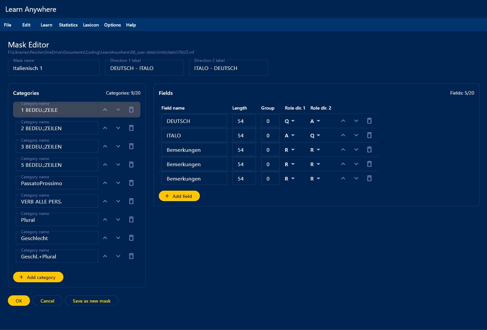
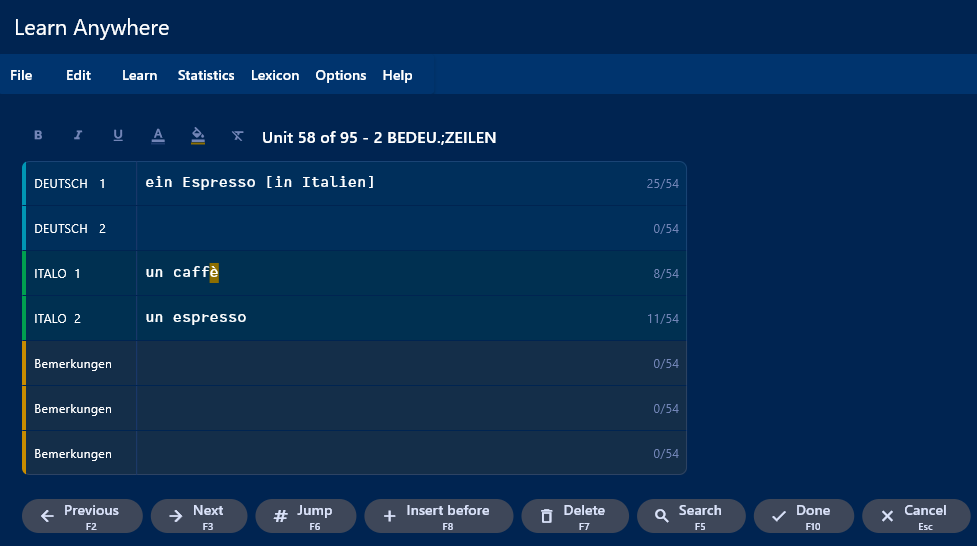
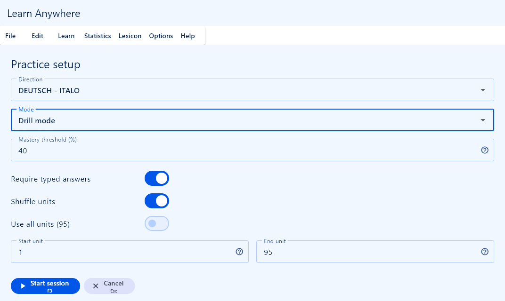
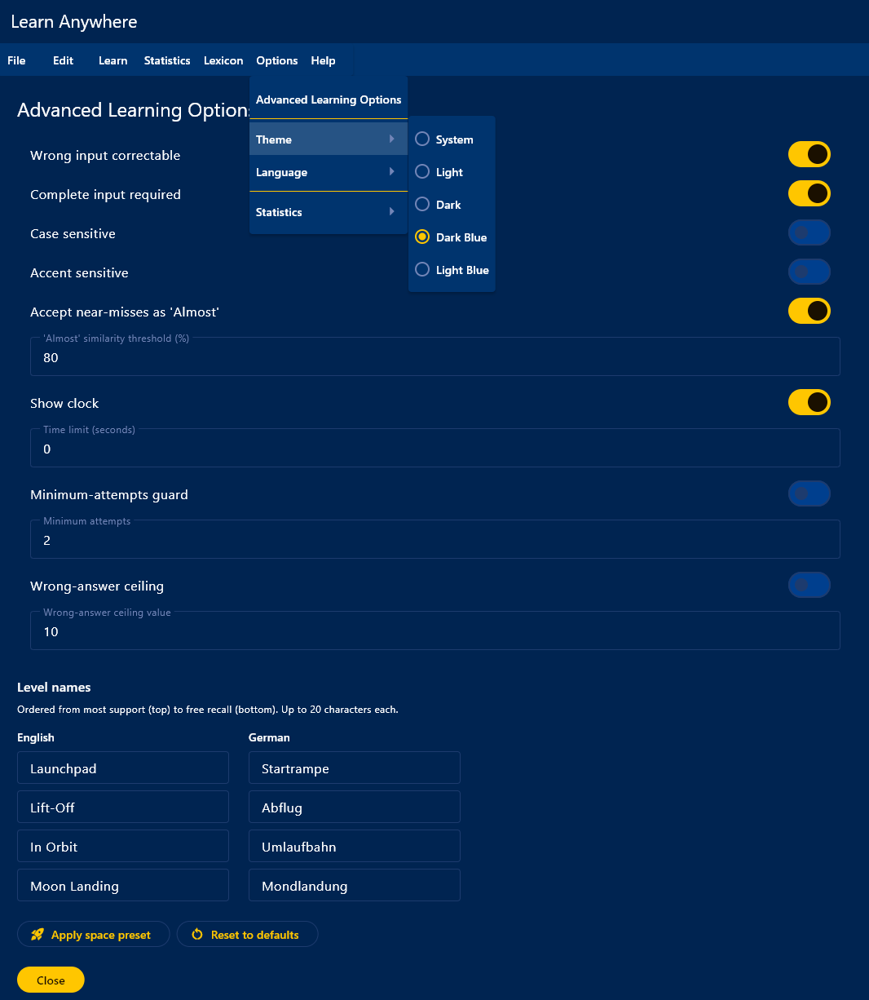
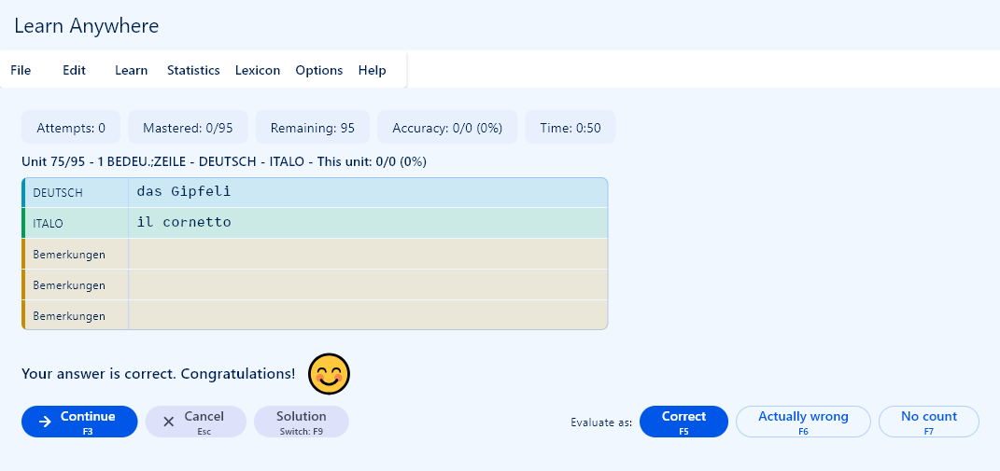
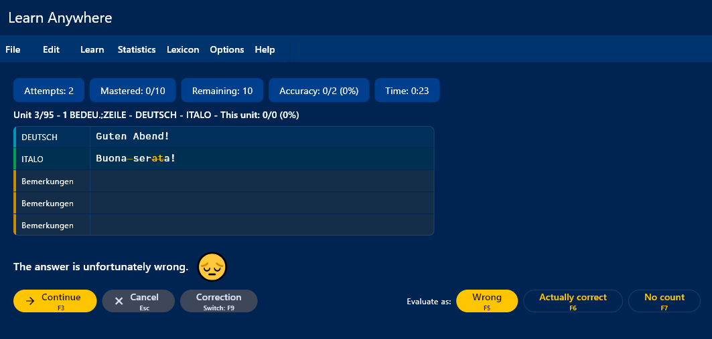
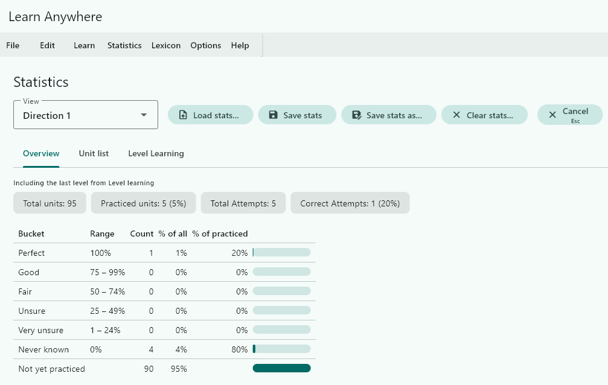
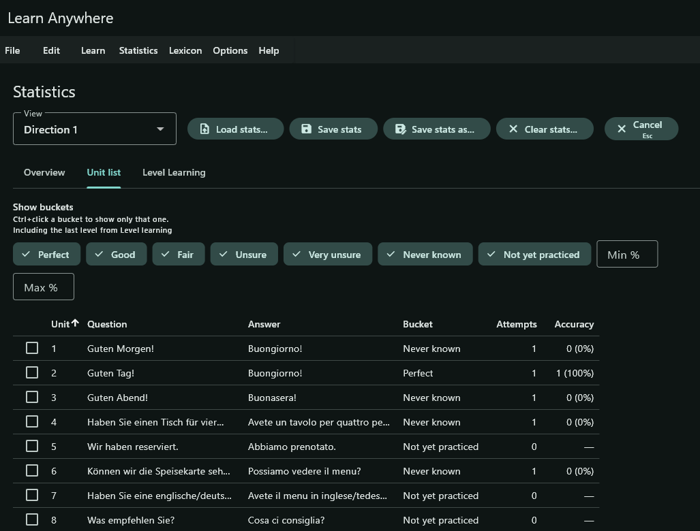

# Learn Anywhere

A cross-platform drilling program for anything you can write down as a set of
connected facts — vocabulary, formulas, dates, chemical symbols, legal paragraphs,
anatomy terms.

Learn Anywhere is a modern rebuild of the DOS-era German program *Lern PC plus*
(© 1990/92 Ulrich Veigel Softwareservice), written in Flutter for **Windows** and
**Linux**, with a read-only Android companion app.

Nothing about any subject is built in. You describe what one card looks like — its
fields, their roles, and which way round they can be asked — and the program handles
the asking, the grading and the bookkeeping. Your material stays in plain, readable
JSON files that you own.

## AI-Assisted Development

All code, documentation and configuration in this project was written by AI. The
first version was built with OpenAI's Codex via the
[ChatGPT extension for VS Code](https://marketplace.visualstudio.com/items?itemName=openai.chatgpt),
working from a build specification drafted by me and refined by ChatGPT. Development
since then has been done with Claude (Anthropic): feature ideas and implementation
approaches worked out in conversation in the Claude app, then turned into prompts for
[Claude Code for VS Code](https://marketplace.visualstudio.com/items?itemName=anthropic.claude-code),
which wrote the code.

### My Role

- **Feature documentation of the original** — Going through *Lern PC plus* screen
  by screen to write down how it behaved, what its data rules were and which keys
  did what, none of which existed in written form
- **Feature proposals** — Deciding which of the original's features to keep, which
  to drop, and what to add that it never had
- **Specification review** — Reading the generated build specification closely and
  correcting it before any code was written
- **Design decisions** — Working through feature ideas and implementation options
  with Claude, and deciding which approach to build
- **Testing** — Running the app, finding bugs, verifying features
- **Orchestration** — Managing the AI workflow effectively

## Features

- **Four practice modes.** *Level learning* walks each item down a ladder of
  support, from the full solution shown to free recall. *Drill mode* keeps asking
  until everything reaches your chosen accuracy. *Endless mode* never stops, and
  *Once through* asks each item exactly once.
- **Several card shapes in one deck.** A mask holds up to 20 categories, each with
  its own set of fields. Simple vocabulary, a six-line conjugation table and a
  three-step process can live side by side in the same file, and each is asked in
  the form that suits it.
- **Bidirectional by design.** A mask defines two directions, e.g. German → French and
  French → German, and every field carries a role in each.
- **Answer evaluation you control.** Case and accent sensitivity, whether every field
  must be filled in, an optional *Almost* verdict for near misses, and the ability to
  overrule any verdict the program reaches.
- **Statistics that mean something.** Per-unit, per-direction accuracy grouped into
  seven buckets, with a unit list you can filter and then save as a new deck of
  exactly the items you keep getting wrong.
- **Reads your cards aloud.** A mask says what language each field holds; in a session a
  speaker icon beside the field reads it out through the voices the operating system
  already has. Local, free and offline — nothing is uploaded and nothing is downloaded.
  Windows only for now; Linux ships mute.
- **A lexicon.** Search the units in memory, or sweep a whole folder tree of decks on disk.
- **Rich text in fields.** Bold, italic, underline, colour and highlight, stored portably.
- **English and German** interface and user guide, five themes, a zoom level from 75 % to 200 %, content centred in the window on a wide screen, and full keyboard operation including ALT menu mnemonics.
- **Finds your decks.** Up to three recently opened decks are one click away from the
  welcome screen, and a start folder can be set so every file dialog opens where your
  decks live.
- **An Android companion.** Import your decks onto a phone and keep practising them
  away from the computer: think-only, two taps per card, with its own statistics.
  Read-only by design, so nothing is edited or synced back.
- **No database, no account, no network.** Three plain UTF-8 JSON file types you can read, diff and back up with any tool.


## Screenshots

*Windows builds, shown in a few of the five available themes.*

<table>
<tr>
<td align="center" valign="top">

**Mask editor**

[](screenshots/MaskEditor.png)

</td>
<td align="center" valign="top">

**Unit editor**

[](screenshots/UnitEditor.png)

</td>
</tr>
<tr>
<td align="center" valign="top">

**Practice setup**

[](screenshots/PracticeSetup.png)

</td>
<td align="center" valign="top">

**Advanced learning options**

[](screenshots/Options.png)

</td>
</tr>
<tr>
<td align="center" valign="top">

**Answering a card**

[](screenshots/Learning.png)

</td>
<td align="center" valign="top">

**A wrong answer, corrected**

[](screenshots/Learning_wrong.png)

</td>
</tr>
<tr>
<td align="center" valign="top">

**Statistics overview**

[](screenshots/Statistics.png)

</td>
<td align="center" valign="top">

**Unit list — keep practicing**

[](screenshots/Statistics_List.png)

</td>
</tr>
</table>

## File types

| Extension | Contents |
|---|---|
| `.vok` | A **deck**: ordered learning units, plus a read-only copy of the mask that shapes them |
| `.inf` | A **mask**: the editable definition of categories, fields, roles and directions |
| `.sta` | **Statistics**: attempts and correct answers per unit and direction |

A deck is self-contained and opens correctly even if its `.inf` is missing. The
on-disk contract is documented in [`docs/file-formats.md`](docs/file-formats.md).

## Install

Download the newest **desktop** release — its tag is named `desktop-v*` — from the
[Releases page](https://github.com/PescheHelfer/LearnAnywhere/releases).

**Windows.** Unzip the downloaded folder anywhere you like, keeping its files
together, and run `LearnAnywhere.exe` from inside it. No installer; the program
writes only inside your own user profile.

**Linux.** Download the `.AppImage`, then:

```sh
chmod +x Learn_Anywhere-*.AppImage
./Learn_Anywhere-*.AppImage
```

Build details for the AppImage are in [`packaging/linux/README.md`](packaging/linux/README.md).

**Android.** The companion app is sideloaded, not published on the Play Store. From the
[Releases page](https://github.com/PescheHelfer/LearnAnywhere/releases), take the
`*-arm64-v8a.apk` file of the newest release that carries one: it is the right build for
essentially every phone sold in the last decade. The other two APKs are for older 32-bit
phones and for emulators. Open it with your file manager and allow the installation when
Android asks. Installing a newer APK over an older one keeps your library and statistics.

The companion carries its own version number, independent of the desktop app's, so one
release can pair desktop 0.11.1 with companion 0.7.0. The number in the APK's name is the
companion's.

Android refuses to install a build whose version is older than the installed one, and
says so only as a generic failure. If an install is rejected on a phone that already has
the app, check the version rather than the file.

## Build from source

Requires the Flutter SDK (>= 3.44.0, Dart >= 3.12.2) with desktop support enabled for your platform.

The **Windows** build additionally needs `nuget.exe` on the `PATH`: the speech plugin
fetches the CppWinRT package with it at configure time, and CMake stops with
`nuget.exe not found. Please install it.` when it is missing. Download the single
executable from <https://www.nuget.org/downloads> into any folder on the `PATH`. The
Linux and Android builds do not need it — neither builds the speech plugin.

```sh
git clone https://github.com/PescheHelfer/LearnAnywhere.git
cd LearnAnywhere
dart pub get                 # one pub workspace covers all four packages

melos run analyze            # static analysis across the workspace
melos run test:core          # pure-Dart core suite
flutter test                 # run inside packages/ui_kit and packages/desktop

flutter build windows        # from packages/desktop
flutter build linux          # from packages/desktop

# from packages/mobile; needs the Android SDK and NDK
flutter build apk --split-per-abi --obfuscate --split-debug-info=build/symbols
```

`melos` itself comes from the root dev dependency, so `dart run melos <script>` works
without a global install.

## Documentation

| For | Read |
|---|---|
| Using the program | The user guide — [English](packages/ui_kit/assets/help/en/00-index.md) · [Deutsch](packages/ui_kit/assets/help/de/00-index.md). The same text ships inside the app under **Help ▸ User guide** (`F1`). |
| Working on the code | [`ARCHITECTURE.md`](ARCHITECTURE.md), then [`docs/`](docs/README.md) |
| Data formats | [`docs/file-formats.md`](docs/file-formats.md) |
| Cross-platform rules | [`CLAUDE.md`](CLAUDE.md) and [`packages/desktop/CLAUDE.md`](packages/desktop/CLAUDE.md) |

## Project layout

One pub workspace, four packages:

| Package | Purpose |
|---|---|
| [`packages/core`](packages/core) | Pure Dart: domain model, file formats, learning engines, settings, message catalogs. Never imports Flutter. |
| [`packages/ui_kit`](packages/ui_kit) | Shared Flutter themes, tokens, rich-text rendering, widgets, and the bundled user guide. |
| [`packages/desktop`](packages/desktop) | The Windows and Linux application. |
| [`packages/mobile`](packages/mobile) | The read-only Android companion (depends only on core and ui_kit). |

## Status

The two applications ship separately, on independent version tracks and with different
feature sets. The desktop application is at 0.11.1; the Android companion is at 0.7.0 and
is distributed as a sideloaded APK.

## Credits

- *Lern PC plus — Universal-Lernprogramm*, © 1990/92 by Ulrich Veigel Softwareservice
  (UVS) — the original program this one rebuilds.
- Modern conversion: SbitFire Software.
- Bundled [Lab Mono](THIRD_PARTY_LICENSES.md) typeface by Martin Wecke, under OFL-1.1.

Learn Anywhere is an independent, unofficial project and is not affiliated with or
endorsed by Ulrich Veigel Softwareservice.

## License

Learn Anywhere is free software: you can redistribute it and/or modify it under the
terms of the GNU General Public License as published by the Free Software Foundation,
either version 3 of the License, or (at your option) any later version. See
[`LICENSE`](LICENSE) for the full text.

Third-party components bundled with the program are listed with their licences in
[`THIRD_PARTY_LICENSES.md`](THIRD_PARTY_LICENSES.md).
